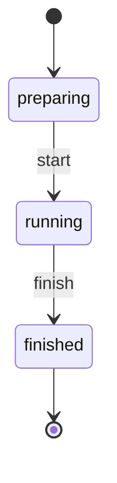
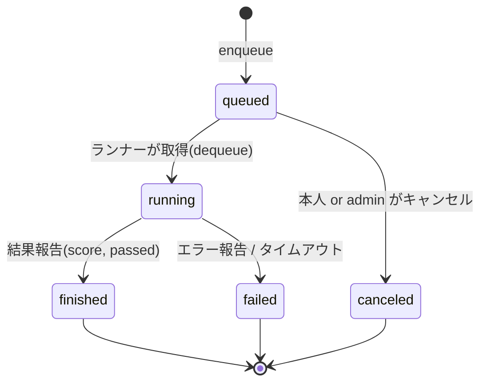

# INUCON Phase 2 設計ドキュメント: ポータル + ベンチランナー

日付: 2026-07-09
ステータス: ドラフト(レビュー待ち)
親ドキュメント: [2026-07-04-inucon-design.md](2026-07-04-inucon-design.md)(全体設計。Phase 2 の位置づけ・技術選定の大枠はそちらで承認済み)

## 背景・目的

Phase 1(手動 MVP)で問題テンプレート・チーム VM 払い出し・ベンチ実行・外部 SSH 経路が手動運用で成立した。Phase 2 はこれを競技として回すためのポータルとベンチランナーを作る:

- 参加者が GitHub ログインして自チームのベンチを撃ち、スコアボードで競える
- ベンチはキューで直列実行され(公平性)、実行ログ・スコア履歴が残る
- ランナーは benchvm に常駐し、ポータルをポーリングしてベンチを実行する

Phase 2 のもう一つの目的は **Effect.ts + DDD の実践**である。docs(本スペック)をドメイン駆動で書き、アーキテクチャ選定の根拠を残す。調査メモ:

- [Effect.ts 最新推奨作法(2026-07)](../research/2026-07-09-effect-ts-current-practices.md)
- [DDD × クリーンアーキテクチャ系の選定](../research/2026-07-09-ddd-architecture-selection.md)

## スコープ

**含む(Phase 2):**

- ポータル: GitHub OAuth ログイン、チーム管理(admin)、ベンチ enqueue、キュー処理、スコアボード、ジョブ履歴・ログ表示、インスタンス台帳(手動登録)
- ベンチランナー(benchvm 常駐): HTTP ポーリング、問題アダプタ経由のベンチ実行、進捗・結果報告
- 問題アダプタの抽象(private-isu 1 問を実装)
- apphost k3s へのデプロイ(manifests)と benchvm への NixOS デプロイ

**含まない(Phase 3 以降に送る):**

- インスタンスの追加/削除ボタン(Proxmox / Cloudflare API オーケストレーション)。Phase 2 のインスタンスは Terraform で払い出したものを admin が台帳登録する
- 普段使い VM(`inucon-<app>`)のセルフサービス
- 複数コンテストの並行開催、コンテストのタイムライン機能(開始/終了の自動制御)
- 通知(Slack/Discord)、リーダーボードのフリーズ等の演出

## ドメインモデル

### ユビキタス言語

| 用語 | 意味 |
| --- | --- |
| Contest(コンテスト) | 1 回の開催。問題を 1 つ持ち、状態(準備中/開催中/終了)でベンチ受付を制御する。Phase 2 では同時に 1 つだけ存在する |
| Problem(問題) | ベンチ対象となる過去問。`problemKey`(例: `private-isu`)で識別し、実体は「VM テンプレート + ランナー側アダプタ」 |
| Team(チーム) | 参加単位。メンバー(User)を持つ。ベンチはチーム単位で撃つ |
| User(ユーザー) | GitHub アカウントで認証された人。admin フラグを持つ |
| Instance(インスタンス) | チームの競技 VM。`inucon-team{N}-{M}` に対応し、チーム VNet 内の privateIp を持つ。Phase 2 では台帳(登録データ)であり、ライフサイクル操作はしない |
| BenchJob(ベンチジョブ) | 1 回のベンチ実行。FIFO キューに積まれ、ランナーが 1 本ずつ実行する。スコア・合否・ログを保持する |
| Runner(ランナー) | benchvm 上の常駐プロセス。ポータルの runner API をポーリングしてジョブを取得・実行・報告する。shared token で認証 |
| Enqueue(エンキュー) | チームメンバーがベンチ対象を指定してジョブをキューに積むこと |
| Scoreboard(スコアボード) | チームごとの最新スコア・最高スコアの一覧 |

### 集約と不変条件

集約は 4 つ。関数型 DDD の方針(調査メモ §3, §4)に従い、**集約 = Effect Schema によるイミュータブルなデータ定義 + 純粋な状態遷移関数(`Either<DomainError, NewState>` を返す)** で表現する。ドメイン層は Effect の runtime 型(`Effect<A, E, R>`)に依存しない(`Schema` / `Either` / `Option` のデータ語彙まで)。

#### Contest

- フィールド: `id`, `name`, `problemKey`, `status`
- 状態機械: `preparing → running → finished`(前方一方向)
- 不変条件: **ベンチの enqueue は `running` のときだけ許可**(閉会後・準備中の誤爆を防ぐ)
- Phase 2 では 1 レコードのみ(seed で作成し admin API で状態遷移)。複数開催は Phase 4



#### Team / User

- Team: `id`, `name`, `teamNumber`(VNet 番号 N と一致)、メンバーの userId 一覧
- User: `id`, `githubLogin`, `githubId`, `displayName`, `isAdmin`
- 不変条件: ユーザーは同時に 1 チームにのみ所属。`teamNumber` は一意(VNet/サブネットに 1:1 対応)
- チーム作成・メンバー割当は admin のみ(Phase 2 では自己登録なし。身内開催で十分)

#### Instance

- フィールド: `id`, `teamId`, `index`(`inucon-team{N}-{M}` の M)、`privateIp`, `status`
- Phase 2 の状態: `active` のみ(admin が登録/削除する台帳)。Phase 3 で `creating → running → stopped → deleting` の状態機械に拡張する(親スペックのコンポーネント設計 §3)
- 不変条件: `privateIp` は所属チームのサブネット `10.100.<teamNumber>.0/24` 内でなければならない(登録時に検証)

#### BenchJob(キューの中心)

- フィールド: `id`, `teamId`, `targetIp`, `targetPort`(既定 80)、`status`, `score`, `passed`, `errorMessage`, `log`, `enqueuedAt`, `startedAt`, `finishedAt`
- 状態機械:



- 不変条件:
  1. **チームごとに `queued` または `running` のジョブは同時に 1 本まで**(本家仕様。連打防止)
  2. **全体でも `running` は同時に 1 本まで**(順番実行。ランナーが 1 台なので自然に満たされるが、dequeue 側でも保証する)
  3. `targetIp` はそのチームのサブネット内のみ(enqueue 時に検証。外部 IP へのベンチは禁止 — 親スペック「ベンチ対象の指定」)
  4. `running` のままハートビート(進捗報告)が `JOB_TIMEOUT`(既定 10 分)途絶えたら `failed` にする(ランナー異常死からの回復。回収はポータル側の常駐ワーカーが行う)

### ドメインイベント(Phase 2 では記録のみ)

イベントソーシングはしない。状態遷移はテーブル更新で表現し、履歴が要るもの(ベンチ結果)は BenchJob 自体が履歴レコードになる。ドメインイベント基盤(outbox 等)は YAGNI。

## アーキテクチャ

### 選定: 軽量ヘキサゴナル 3 層(Effect ネイティブ)

調査メモ(DDD × クリーンアーキ選定)の比較のとおり、**A. 軽量ヘキサゴナル 3 層**を採用する。

- **domain**: Schema によるモデル定義 + 純粋な状態遷移関数 + ドメインエラー。Effect runtime 非依存
- **application**: ユースケース(`Effect.gen` 関数)と port(`Context.Tag`)。トランザクション境界・認可判断はここ
- **infrastructure**: adapter 実装。@effect/sql-sqlite-node のリポジトリ Layer、GitHub OAuth クライアント、HttpApi ハンドラ、常駐ワーカー

選定根拠(詳細は調査メモ):

1. Effect の `Context.Tag` + `Layer` が依存性逆転と DI を言語機能として提供するため、古典クリーン 4 層の Interface Adapters 層は儀式にしかならない。Effect コミュニティの主要実例(hex-effect, effect-app, Spiko)は 3 層に収斂している
2. 本プロジェクトの複雑さの核は Instance / BenchJob の状態機械という「濃いドメイン」であり、domain を中心に置くヘキサゴナルが守りやすい。同ドメインの先行実装 piscon-portal-v2(Go)も domain 中心
3. 開発者 1 人 + AI エージェント、テーブル 10 個以下の規模では 4 層の儀式(DTO 変換・1 実装 interface)は投資対効果が合わない

不採用案: **B. 古典クリーン 4 層**(Effect と二重化する)、**C. vertical slice**(状態機械が slice を跨いで共有され崩れる)。

### 依存の向き

```
HttpApi ハンドラ / ワーカー(infrastructure, 入力 adapter)
        │  呼ぶ
        ▼
ユースケース(application)──依存──> port(Context.Tag、application 内で宣言)
        │  使う                         ▲ 実装(Layer)
        ▼                               │
ドメイン(domain, 純粋)          リポジトリ / OAuth / Clock(infrastructure, 出力 adapter)
```

- domain は何にも依存しない(effect の Schema/Either/Option のみ import)
- application は domain と port に依存。port の実装は知らない
- infrastructure は application の port を実装し、domain の Schema で入出力を検証する
- Layer の合成(composition root)は `main.ts` の 1 箇所のみ

### 技術スタック(バージョンは調査メモ §1 で確定)

| 項目 | 選定 |
| --- | --- |
| ランタイム / 言語 | Node.js 22 LTS / TypeScript(strict) |
| コアライブラリ | effect **3.21.x**(v4 は Beta のため追わない。安定後に codemod で移行) |
| HTTP | @effect/platform の **HttpApi**(宣言的定義。OpenAPI 自動生成、ランナー用クライアントを `HttpApiClient` で導出) |
| DB | SQLite + **@effect/sql-sqlite-node**(Migrator でマイグレーション、WAL) |
| テスト | **@effect/vitest**(`it.effect` + TestClock。ドメイン純粋関数は素の vitest) |
| パッケージ管理 | pnpm workspace(monorepo) |
| フロントエンド | React + Vite の最小 SPA(`portal/web/`)。ビルド成果物をポータルが静的配信 |

フロントエンドの選定理由: 親スペックで「実装計画時に選定」としていた。スコアボード・ジョブログの自動更新(ポーリング)があるため素の SSR より SPA が素直で、React + Vite は AI エージェントによる生成・修正の実績が最も安定している。UI は最小限(デザイン凝らない)。

### リポジトリ構成(pnpm workspace)

```
portal/            ポータルサーバー(Effect アプリ)
  src/
    domain/        Schema モデル・状態遷移関数・ドメインエラー(純粋)
    application/   ユースケース + port(Context.Tag)
    infrastructure/
      sql/         SqliteClient Layer・Migrator・リポジトリ実装・migrations/
      github/      GitHub OAuth adapter(HttpClient)
      http/        HttpApi 定義の実装(HttpApiBuilder.group)・認証ミドルウェア・静的配信
      worker/      ジョブタイムアウト回収の常駐 fiber(Layer.scopedDiscard)
    main.ts        composition root(Layer 合成 → NodeRuntime.runMain)
  web/             React + Vite SPA(ビルドして portal が配信)
shared/            ポータルとランナーで共有する契約
  src/
    api.ts         HttpApi 定義(runner グループ含む全 API 契約)
    schemas.ts     API 入出力の Schema(ドメイン Schema のうち境界に出るもの)
runner/            ベンチランナー(Effect アプリ、benchvm 常駐)
  src/
    adapters/      問題アダプタ(private-isu.ts)
    main.ts        ポーリングループ(HttpApiClient で shared/api.ts から型付きクライアント導出)
deploy/            apphost k3s マニフェスト(Deployment/Service/Ingress/PVC)
```

方針: **HttpApi 定義(契約)を shared に置き、ポータルは実装を、ランナーはクライアントを導出する**。ドメイン(状態遷移関数)は portal/src/domain に置き、ランナーには持ち込まない(ランナーは契約だけ知っていればよい)。

## コンポーネント設計

### 1. 認証(GitHub OAuth + セッション)

- ログイン: `GET /auth/github` → ランダムな `state` を発行し(短命 cookie に保存)GitHub authorize へリダイレクト → `GET /auth/github/callback?code=&state=` で **`state` を必須検証**(不一致は 400。login CSRF 対策)→ code をトークン交換(HttpClient、調査メモ §11)→ GitHub API でユーザー情報取得 → users を upsert → セッション発行。PKCE は GitHub OAuth Apps がサーバーサイドフローで強制検証しないため採用せず、`state` + client secret(confidential client)で担保する
- セッション: ランダム 256bit の sessionId を `sessions` テーブルに保存し、HttpOnly + Secure + SameSite=Lax の cookie で持つ。有効期限 30 日。JWT は使わない(失効管理が面倒、身内規模で DB 参照コストは無視できる)
- 認可は HttpApiMiddleware で実装(調査メモ §3 の現行形):
  - `Authentication`(cookie → CurrentUser 提供)
  - `AdminOnly`(CurrentUser.isAdmin 必須)
  - `RunnerAuth`(`Authorization: Bearer <RUNNER_TOKEN>`、runner グループ専用)
- admin の初期付与: 環境変数 `ADMIN_GITHUB_LOGINS`(カンマ区切り)に載っている githubLogin はログイン時に isAdmin=true
- GitHub OAuth App の client secret / RUNNER_TOKEN は `Config.redacted` で扱う(ログ非出力)。セッションは DB 保存のランダム ID なので署名鍵は不要(改ざんは DB 照合で無効化される)

### 2. HTTP API(HttpApi グループ設計)

すべて `/api` 配下。OpenAPI ドキュメントを `/docs` に自動生成(Swagger UI)。

| グループ | エンドポイント | 認可 | 内容 |
| --- | --- | --- | --- |
| auth | `GET /auth/github` / `GET /auth/github/callback` / `POST /api/auth/logout` / `GET /api/me` | 公開 / セッション | ログインフロー、自分+所属チーム情報 |
| contest | `GET /api/contest` | セッション | 現在のコンテスト(名前・問題・状態) |
| scoreboard | `GET /api/scoreboard` | セッション | チームごとの最新/最高スコア一覧 |
| teams | `GET /api/teams` / `POST /api/teams` / `PUT /api/teams/:id/members` | 参照はセッション、変更は admin | チーム一覧、作成、メンバー割当 |
| instances | `GET /api/teams/:id/instances` / `POST /api/instances` / `DELETE /api/instances/:id` | 参照は当該チーム or admin、変更は admin | インスタンス台帳 |
| bench | `POST /api/bench-jobs`(enqueue)/ `GET /api/bench-jobs?teamId=` / `GET /api/bench-jobs/:id` / `POST /api/bench-jobs/:id/cancel` | enqueue/cancel はチームメンバー(自チームのみ)。一覧(スコア・状態)は全員可、**詳細(ログ)は自チーム + admin のみ**(ログはチューニング戦略が漏れるため) | エンキュー、履歴、詳細(ログ含む)、キャンセル |
| admin | `POST /api/admin/contest/start` / `POST /api/admin/contest/finish` | admin | コンテスト状態遷移 |
| runner | `POST /api/runner/jobs/poll` / `POST /api/runner/jobs/:id/progress` / `POST /api/runner/jobs/:id/finish` | RunnerAuth | 後述 |

エラーは `Schema.TaggedError` + status 注釈で宣言し(調査メモ §6)、ドメインエラー(例: `TeamJobAlreadyQueued`, `TargetIpOutOfSubnet`, `ContestNotRunning`)を 409/422 にマップする。

### 3. ベンチキュー(DB FIFO)

piscon-portal-v2 / 本家 portal と同じ **DB テーブル + status カラムの pull 型キュー**(調査メモ DDD §6)。

- enqueue(ユースケース): `withTransaction` 内で (a) Contest が running か、(b) チームに queued/running が無いか、(c) targetIp がチームサブネット内か、を検証して INSERT
- dequeue(runner poll): `withTransaction` 内で「`running` が全体に 1 本も無いこと」を確認し、`UPDATE bench_jobs SET status='running', started_at=... WHERE id = (SELECT id FROM bench_jobs WHERE status='queued' ORDER BY enqueued_at LIMIT 1) RETURNING *` のアトミック更新。空なら 204 相当(`Option.none`)を返す
- SQLite は単一プロセス・WAL なのでこの排他で十分。行ロック競合の考慮は不要
- タイムアウト回収: ポータル内の常駐 fiber(`Layer.scopedDiscard` + `Effect.repeat(Schedule.spaced("30 seconds"))`、調査メモ §12)が「`running` かつ最終進捗更新から `JOB_TIMEOUT` 経過」を `failed` に落とす

### 4. ベンチランナー(benchvm)

- Effect アプリ。`HttpApiClient.make(api, ...)` で shared の契約から型付きクライアントを導出
- メインループ: `poll → (ジョブなし: 2 秒待って再ポーリング) → (ジョブあり: 実行)` を `Effect.repeat(Schedule.spaced("2 seconds"))` + `Effect.catchAllCause(logError)` で回す(ワーカーは死なない)
- ジョブ実行: 問題アダプタに委譲。実行中は 5 秒ごとに progress を POST(それまでの stdout/stderr の増分と、パース可能なら途中スコア)。progress はポータル側でハートビートを兼ねる
- 完了: アダプタが stdout から `{ score, passed, messages }` を抽出し finish を POST。プロセス異常終了・パース不能は `failed` として報告
- 認証: `RUNNER_TOKEN`(ポータルと共有、NixOS の agenix で配布)
- 接続先: LAN 内直結 `http://192.0.2.20:<port>`(apphost k3s の NodePort または Ingress のローカル解決)。Cloudflare Tunnel は経由しない(内→内で外に出る意味がない)

### 5. 問題アダプタ

「問題 = テンプレート ID + アダプタ」(親スペック)。アダプタはランナー内の TS モジュール:

```ts
interface ProblemAdapter {
  readonly problemKey: string  // "private-isu"
  readonly command: (target: { ip: string; port: number }) => Command.Command  // ベンチバイナリの起動
  readonly parseResult: (stdout: string) => Either<AdapterParseError, BenchResult>
  readonly parsePartialScore: (stdoutSoFar: string) => Option<number>  // 進捗表示用(任意)
}
```

- private-isu 実装: `/home/isucon/private_isu.git/benchmarker/bin/benchmarker -u ./userdata -t http://<targetIp>` を実行し、JSON 出力(`{pass, score, ...}`)をパース(Phase 1 の実測手順 `problems/private-isu/README.md` と同一)
- 2 問目(Phase 4)でこの抽象の妥当性を検証する

### 6. データベース(SQLite、8 テーブル)

| テーブル | 主なカラム |
| --- | --- |
| users | id, github_id (uniq), github_login, display_name, is_admin, created_at |
| sessions | id (sessionId), user_id, expires_at, created_at |
| teams | id, name, team_number (uniq), created_at |
| team_members | team_id, user_id (uniq: 1 ユーザー 1 チーム) |
| contests | id, name, problem_key, status |
| instances | id, team_id, idx, private_ip, status, created_at |
| bench_jobs | id, team_id, target_ip, target_port, status, score, passed, error_message, enqueued_at, started_at, finished_at, last_progress_at |
| bench_job_logs | job_id (PK), log(TEXT、progress で追記) |

- マイグレーションは @effect/sql の Migrator(番号付き TS、前方専用)
- ログを別テーブルにするのは、一覧クエリ(scoreboard・履歴)が数百 KB の TEXT を引きずらないため
- ファイルは k3s の PVC(`local-path`)上。バックアップは Phase 2 では手動(`sqlite3 .backup`)、運用が始まったら cron を検討

### 7. フロントエンド(最小 SPA)

ページ構成(React + Vite、`portal/web/`):

- **ログイン**: 「GitHub でログイン」ボタンのみ
- **ダッシュボード / スコアボード**: チームごとの最新・最高スコア(10 秒ポーリング)
- **チームページ**: 自チームのインスタンス一覧、ベンチ対象選択(インスタンスのドロップダウン + ip:port 直接入力)、エンキューボタン、ジョブ履歴
- **ジョブ詳細**: 状態、スコア、ログ(実行中は 5 秒ポーリングで追記表示)
- **admin ページ**: チーム作成・メンバー割当、インスタンス登録、コンテスト開始/終了

API 型は HttpApi 定義から生成される OpenAPI を参照するか、shared の Schema を直接 import する(同一 monorepo なので後者が簡単)。

### 8. デプロイ

- **ポータル**: Dockerfile(multi-stage: pnpm build → node:22-slim)。apphost k3s に Deployment(replicas=1、SQLite なので水平スケール不可)+ PVC + Service + Ingress。外部公開は既存の apphost cloudflared tunnel に `inucon.kisen.one` を追加(Cloudflare Access は掛けない — ポータル自身が GitHub OAuth を持ち、スコアボードは参加者全員が見る)
- **ランナー**: nixos-config-private の `hosts/benchvm` に systemd サービスとして追加(node + ビルド成果物、または Docker)。`RUNNER_TOKEN` は agenix。ベンチバイナリ・userdata は Phase 1 で配置済みのパスを流用
- CI(GitHub Actions)によるイメージビルド・自動デプロイは Phase 2 のスコープ外(手動 `kubectl apply` で開始し、頻度が上がったら足す)

## 公平性・セキュリティ(Phase 2 で効くもの)

- ベンチ対象はチーム自身のサブネット内のみ(enqueue 時と、ランナー実行直前の二重検証)
- キューは FIFO・全体同時 1 本で、チーム間で実行環境が同一(benchvm 1 台)
- runner API は shared token。ポータルの管理操作は isAdmin のみ
- セッション cookie は HttpOnly/Secure。CSRF は SameSite=Lax + 変更系 API の JSON Content-Type 必須で防ぐ(フォーム POST を受けない)
- 機密(client secret / RUNNER_TOKEN)は `Config.redacted` + agenix / k8s Secret。リポジトリに入れない

## テスト戦略

- **domain**: 状態遷移関数の純粋テスト(素の vitest)。不正遷移が `Either.left` になることを網羅
- **application**: ユースケースをインメモリ port(テスト用 Layer)で `it.effect` テスト。キュー不変条件(チーム同時 1 本、全体同時 1 本、サブネット検証)はここで固める
- **infrastructure/sql**: リポジトリ実装を SQLite `:memory:` + Migrator で `it.layer` テスト(dequeue のアトミック性含む)
- **タイムアウト回収ワーカー**: TestClock で時間を進めて検証(調査メモ §7)
- **E2E 相当**: HttpApi をテスト用 Layer 一式で起動し、HttpApiClient で「enqueue → poll → progress → finish → scoreboard 反映」の一連を 1 本通す
- フロントエンドは型チェック + 手動確認(Phase 2 では UI の自動テストはしない)

## リスク・未確認事項

- **Effect.ts の習熟**(親スペックからの持ち越し): 実装計画の最初のタスクを「walking skeleton(HttpApi + SQLite + 1 エンドポイント + テスト + デプロイ)」にして、フレームワークの想定齟齬を最初に潰す
- **HttpApi のセッション cookie ミドルウェア**: HttpApiSecurity は bearer/apiKey/basic が中心で、cookie セッションは apiKey(cookie ソース)扱いになる。walking skeleton で書き味を確認する
- **SQLite 単一ファイル + k3s PVC**: replicas=1 前提。デプロイ時のダウンタイムは数秒(身内利用で許容)
- **ランナー→ポータルの LAN 直結**: k3s の Service 公開方式(NodePort か Ingress の LAN 解決か)は実装計画時に apphost の現状構成を見て決める
- **v4 移行**: Effect v4 が安定したら移行する(公式 codemod 待ち。shared に契約を集約してあるので影響範囲は限定的)

## フェーズ内マイルストーン(実装計画の粒度の目安)

1. **Walking skeleton**: pnpm workspace + portal 最小(HttpApi 1 本 + SQLite + Migrator + it.effect テスト)+ Docker + k3s デプロイまで貫通
2. **ドメイン + 認証**: domain 一式(状態遷移関数 + テスト)、GitHub OAuth、セッション、admin
3. **キューとチーム**: チーム/インスタンス管理、enqueue/dequeue/タイムアウト回収、runner API
4. **ランナー**: ポーリングループ + private-isu アダプタ + benchvm デプロイ、実ベンチ貫通
5. **UI とスコアボード**: SPA 一式、スコアボード、ジョブログ表示
6. **本番検証**: 2 チーム構成で実ベンチを回し、Phase 1 の手動フローを置き換える
