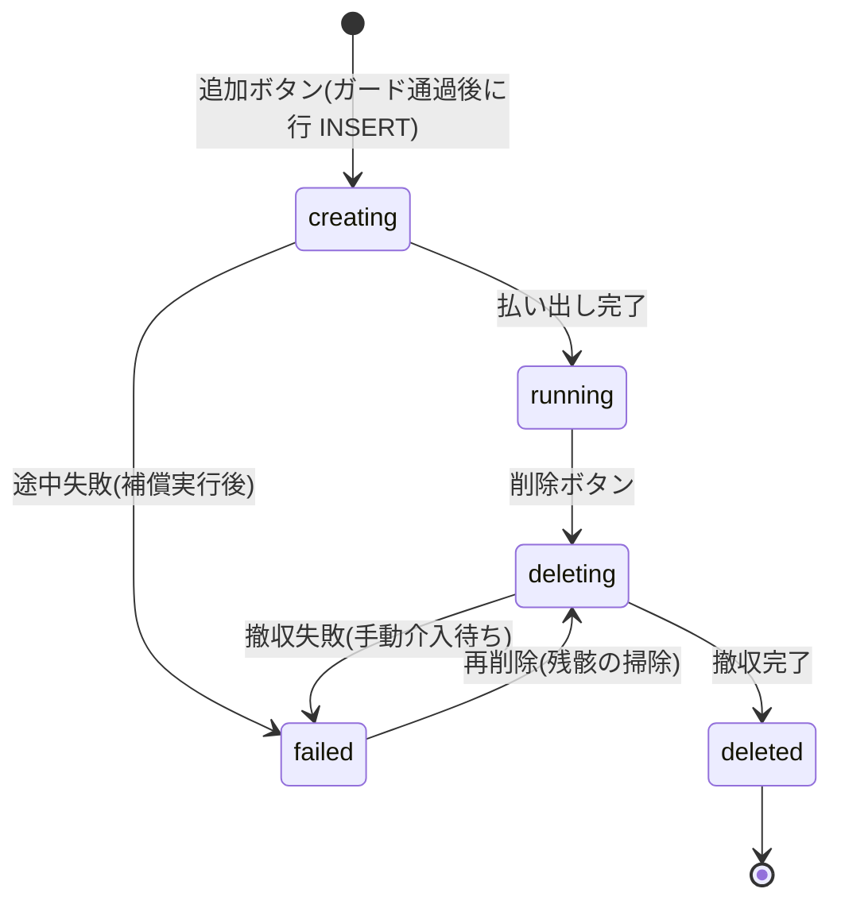

# INUCON Phase 3 設計ドキュメント: セルフサービス(インスタンス操作 + 招待自動化)

日付: 2026-07-10
ステータス: ドラフト(レビュー待ち)
親ドキュメント: [2026-07-04-inucon-design.md](2026-07-04-inucon-design.md)(全体設計)/ [2026-07-09-phase2-portal-design.md](2026-07-09-phase2-portal-design.md)(ポータル基盤。アーキテクチャ・技術スタック・開発規約は Phase 2 のものを踏襲し、本書では差分のみ定義する)

## 背景・目的

Phase 2 でポータル(キュー・スコアボード・チーム管理)が本番稼働した。Phase 3 は運営の手作業を 2 つ潰す:

1. **インスタンスのセルフサービス**: 現状インスタンスの増減は Terraform(運営作業)。チームメンバー自身がポータルの「追加/削除ボタン」で、クォータ内で競技 VM を増減できるようにする(親スペックのコンポーネント設計 §3「インスタンス管理」の実装)
2. **メンバー招待の自動化**: 現状の招待は 3 点セットの手作業(ポータルのチーム割当 / Cloudflare Access のメール追加 / VM への SSH 鍵注入)。admin が「GitHub アカウント + メール」を 1 回入力すれば全部走るようにする

## スコープ

**含む:**

- Instance 状態機械の有効化(Phase 2 は `active` のみの台帳だった)とオーケストレーション: Proxmox clone → cloud-init(IP/鍵)→ 起動 → Cloudflare(DNS / tunnel ingress / Access)→ running。削除はその逆 + 補償処理
- ガード: チームごとのインスタンス上限(Contest 設定)、クローン前の eevee 空き RAM 確認、VM スペック固定(2vCPU/4GB)
- 招待フロー: admin の 1 操作で「チーム割当(未ログインなら初ログイン時に自動所属)+ Access ポリシー更新 + 既存 VM への鍵注入」
- 前提インフラ: ポータル用 Proxmox API トークン(最小権限)、benchvm トンネルの remotely managed 化、k8s Secret への各トークン追加

**含まない(後続タスク/フェーズ):**

- 普段使い VM(`inucon-<app>`)の解禁 — 本フェーズで作る払い出し基盤の別テナント利用であり、基盤完成後の小さな追加タスクとして切り出す(Phase 3.5)
- VM の stop/start(一時停止)操作 — 追加/削除のみ。停止運用が欲しくなったら Phase 4
- Terraform で払い出した既存 VM の「取り込み」の自動化 — 既存 2 台は手動で台帳整合を取る(移行手順を実装計画に含める)
- チーム間分離ルールの TF/ポータル統合(Issue #6 のまま)

## ドメインモデル(Phase 2 からの差分)

### ユビキタス言語(追加)

| 用語 | 意味 |
| --- | --- |
| Provisioning(払い出し) | インスタンス 1 台を使える状態にする一連の処理(clone → 設定 → 起動 → 経路登録) |
| Teardown(撤収) | 払い出しの逆。経路削除 → VM 停止・破棄 |
| Invite(招待) | チームへのメンバー追加の 1 操作。ポータル所属・SSH 経路(Access)・VM 鍵の 3 点を同期させる |
| Quota(クォータ) | チームごとのインスタンス上限。Contest が持つ(全チーム同数、既定 3) |

### Instance 集約(状態機械の有効化)

- フィールド追加: `vmid`(Proxmox VM ID)、`errorMessage`、`updatedAt`
- 状態機械(Phase 2 の `active` を `running` に読み替えて拡張):



- 不変条件:
  1. **チームの creating+running 数 ≤ Contest.instanceQuota**(既定 3。作成時にトランザクション内で再検証 — BenchJob の insertIfAllowed と同パターン)
  2. **チームごとに進行中(creating/deleting)のオーケストレーションは同時 1 本**(条件付き更新で保証。連打・競合防止)
  3. `vmid` は `1000 + teamNumber × 100 + index`(実績: team1-1 = 1101)。IP は `10.100.<teamNumber>.1<index>`(既存規則)
  4. **削除対象の IP を target とする BenchJob が queued/running のときは削除拒否(409)**(ベンチ中の対象消失を防ぐ)
  5. VM スペックは固定(2vCPU/4GB/20GB。ユーザー入力を受けない — 公平性)
- `deleted` は行を消さず status で残す(監査・index 再利用の判断材料)。同じ index の再作成は deleted/failed の行があっても可(UNIQUE(team_id, idx) は「進行中/稼働中」に限定する部分インデックスへ変更)

### Invite(集約ではなくユースケース + 招待レコード)

- `team_invites` レコード: `githubLogin`, `teamId`, `email`, `invitedAt`。**未ログインユーザーの事前割当**を表す(Phase 2 の「users に居ない login は 422」制約の置き換え)。本人が初ログインしたとき自動でチームに所属し、レコードは消費される
- 既ログインユーザーの招待は即時割当(従来の setMembers 経路)
- Invite の実行結果は 3 点それぞれの成否を持つ(部分失敗を隠さない): `{ portal: ok, access: ok|error, sshKeys: [{instance, ok|error}] }`。失敗した項目は admin が再実行できる(冪等)

## アーキテクチャ(Phase 2 の 3 層に port を追加)

新しい出力 port(application 層で宣言、infrastructure に Live):

```ts
// Proxmox VE API(https://192.0.2.10:8006/api2/json)。トークン認証
export class ProxmoxPort extends Context.Tag("app/ProxmoxPort")<ProxmoxPort, {
  readonly cloneVm: (args: { templateVmid: number; newVmid: number; name: string }) => Effect<void, ProxmoxError>
  readonly configureCloudInit: (args: { vmid: number; ip: string; gateway: string; sshKeys: string }) => Effect<void, ProxmoxError>
  readonly setVnet: (args: { vmid: number; bridge: string }) => Effect<void, ProxmoxError>
  readonly startVm: (vmid: number) => Effect<void, ProxmoxError>
  readonly stopAndDestroyVm: (vmid: number) => Effect<void, ProxmoxError>   // 冪等(無ければ成功扱い)
  readonly waitForGuestAgent: (vmid: number, timeoutMillis: number) => Effect<void, ProxmoxError | ProvisionTimeout>
  readonly guestExec: (args: { vmid: number; command: ReadonlyArray<string> }) => Effect<{ exitcode: number; out: string }, ProxmoxError>
  readonly getNodeFreeMemBytes: Effect<number, ProxmoxError>
}>() {}

// Cloudflare API(DNS / Tunnel remote config / Access)。Phase 1-2 の runbook 実績の API 化
export class CloudflarePort extends Context.Tag("app/CloudflarePort")<CloudflarePort, {
  readonly ensureInstanceRoute: (args: { hostname: string; ip: string }) => Effect<void, CloudflareError>
    // = DNS CNAME(→ benchvm tunnel)+ tunnel ingress(ssh://ip:22)の追加。冪等
  readonly removeInstanceRoute: (hostname: string) => Effect<void, CloudflareError>
  readonly ensureAccessApp: (args: { hostname: string; emails: ReadonlyArray<string> }) => Effect<void, CloudflareError>
    // Access アプリ作成 or ポリシー全置換(既存 runbook の PUT 方式)
  readonly removeAccessApp: (hostname: string) => Effect<void, CloudflareError>
}>() {}

// GitHub 公開鍵の取得(https://github.com/<login>.keys)
export class GithubKeysPort extends Context.Tag("app/GithubKeysPort")<GithubKeysPort, {
  readonly fetchKeys: (login: string) => Effect<ReadonlyArray<string>, GithubKeysError>  // 空は GithubKeysError(鍵未登録)
}>() {}
```

- 各 port の Live は @effect/platform HttpClient。テストはインメモリ差し替え(Phase 2 と同じ)
- **オーケストレーションの実行**: HTTP ハンドラは「creating 行の作成」までで即応答し、実処理はポータル内の常駐ワーカー(TimeoutSweeper と同型の Layer + ポーリング)が拾って進める。**プロセス再起動で孤児にならない**(進行状態は DB にあり、ワーカーが再開/補償する)ことを設計の柱にする
- 補償(saga): 各ステップは「ここまで作ったもの」を DB の progress カラム(`clone_done`, `started`, `route_done` 等のステップ列)に記録し、失敗時は逆順に掃除して `failed` へ。Cloudflare 系は全操作を冪等(ensure/remove)に作り、リトライ・再実行に耐える

## 招待フロー

```
admin: POST /api/admin/teams/:id/invites { githubLogin, email }
  1. users に存在 → 即所属(既存 setMembers 相当、他チーム所属は 409)
     存在しない → team_invites 行を作成(初ログイン時に自動所属 + 行削除)
  2. チームの全インスタンスの Access アプリへ email を追加(ポリシー全置換 PUT:
     現メンバーのメール一覧 + 招待中メール一覧から構成)
  3. チームの running 全 VM に guestExec で authorized_keys 追記
     (GithubKeysPort で取得した鍵を isucon ユーザーへ。重複追記は排除)
  → レスポンスは 3 点の成否。失敗項目は同じ API の再実行で埋める(全ステップ冪等)
```

- メールの保管: `team_invites.email` と、users にも `email` カラムを追加(初ログイン時に invite から引き継ぐ)。Access ポリシー構成の情報源
- インスタンス**新規作成時**は「その時点のチームメンバー+招待中」のメール/鍵で Access アプリと authorized_keys を構成(招待済みの人は新 VM にも最初から入れる)
- メンバー削除(離脱)は Phase 3 では admin の手作業(Access から外す等)。運用頻度が低いため自動化しない(スコープ節)

## セキュリティ

- **Proxmox API トークン(新設)**: portal 専用。権限は必要最小(VM.Clone / VM.Config.* / VM.PowerMgmt / VM.Audit / VM.Monitor(guest agent)/ Datastore.AllocateSpace を、/vms と対象 storage に限定)。**Phase 1 の「root + Administrator」を portal に持ち込まない**。実際に必要な最小セットは Phase 3 冒頭の spike で実測して確定
- **guestExec の使途限定**: コマンドはコード内固定(authorized_keys 追記のみ)。ユーザー入力が混ざるのは鍵文字列だけで、GitHub .keys 由来 + ssh 公開鍵形式の検証を通す(シェルへ渡さず argv 分離)
- **Cloudflare トークン**: 既存権限セット(DNS Edit / Tunnel Edit / Access Apps Edit / Zone Read)を k8s Secret でポータルに注入。ポータル UI からは値に触れない
- インスタンス操作 API はチームメンバー(自チームのみ)+ admin。招待 API は admin のみ
- ホスト名は既存規則 `inucon-team{N}-{M}.kisen.one` を踏襲(公開面の増加はインスタンス分の SSH ホスト名のみで、全て Access 背後)

## DB(migration 0002 — 本番 DB があるため前方専用)

| 変更 | 内容 |
| --- | --- |
| instances | `vmid INTEGER`, `error_message TEXT`, `progress TEXT`, `updated_at INTEGER` 追加。status CHECK を `('creating','running','deleting','deleted','failed')` に拡張(既存 `active` 行は `running` へ UPDATE)。UNIQUE(team_id, idx) を「status IN ('creating','running','deleting')」の部分インデックスに置換 |
| contests | `instance_quota INTEGER NOT NULL DEFAULT 3` 追加 |
| users | `email TEXT` 追加(nullable) |
| team_invites(新規) | `github_login`, `team_id`, `email`, `invited_at`。UNIQUE(github_login) |

## HTTP API(差分)

| エンドポイント | 認可 | 内容 |
| --- | --- | --- |
| `POST /api/teams/:id/instances` | 当該チームメンバー or admin | 追加ボタン。ガード(quota / RAM / 進行中 1 本)通過で creating 行を返す(202 相当)。以後 UI はポーリング |
| `DELETE /api/instances/:id` | 当該チームメンバー or admin | 削除ボタン。running のみ受理(ベンチ対象中は 409)。deleting へ |
| `GET /api/teams/:id/instances` | 既存 | status/errorMessage 込みで返す(ポーリング用) |
| `POST /api/admin/teams/:id/invites` | admin | 招待(上記フロー)。3 点の成否を返す |
| `GET /api/admin/teams/:id/invites` | admin | 招待中一覧 |

Phase 2 の admin 用インスタンス手動登録(POST /api/instances)は「Terraform 製 VM の台帳取り込み」用に残す(vmid を任意指定できる admin 専用経路)。

## UI(差分)

- Team ページ: インスタンス追加ボタン(quota 到達・進行中は無効化+理由)、各行に状態バッジ(creating はスピナー + 5 秒ポーリング)、削除ボタン(確認ダイアログ)
- Admin ページ: 招待フォーム(githubLogin + email)、招待中一覧、招待結果(3 点の成否)表示

## 前提インフラ作業(実装計画の冒頭タスク)

1. **benchvm トンネル(0000aaaa)の remotely managed 化**: 現ローカル ingress(team1-1/team2-1)を API の tunnel configurations に載せ替え。NixOS 側の ingress 定義は apphost 同様「ドキュメント化のみ・実効性なし」の注記に変更(nixos-config-private へ PR)。※apphost での実績(Phase 2)と同じ運用に統一する
2. **Proxmox API トークン作成**(eevee): portal 用・最小権限。値は k8s Secret へ
3. k8s Secret に `PROXMOX_API_TOKEN` / `CF_API_TOKEN` 追加、deployment の envFrom は既存 Secret を流用

## リスク・未確認事項(Phase 3 冒頭の spike で検証)

1. **linked clone + 標準 cloud-init(ipconfig0 / sshkeys)で IP・鍵が入るか**: Phase 1 は cicustom(snippets)で構築したテンプレートのため、clone 後に標準 cloud-init 設定(`qm set --ipconfig0 --sshkeys`)が効くか・cloud-init が新 instance-id で再実行されるかは未検証。駄目な場合の代替: (a) snippets を API で書く(storage upload)、(b) IP/鍵とも guestExec で注入(cloud-init を使わない)。(b) は仕組みが単純なので有力な代替
2. **Proxmox API トークンの最小権限セット**: clone/guest exec に実際に要る privilege を実測で確定
3. **guest agent exec の挙動**: 出力サイズ制限・タイムアウト・isucon ユーザーへのファイル書き込み権限
4. **RAM ガードの閾値**: ARC を考慮した「空き」の定義(free + arc の可縮小分)。Phase 1 実測(ARC 4GiB 上限)を前提に閾値を決める
5. Cloudflare Access アプリ数の上限(無料枠 50 アプリ?)— インスタンス数分作るため、上限値を確認

## フェーズ内マイルストーン(実装計画の粒度の目安)

1. **Spike + 前提インフラ**: リスク 1〜3 の実測、benchvm トンネル移行、Proxmox トークン、結果をスペックに反映
2. **Domain + migration**: Instance 状態機械・遷移関数・0002 migration・既存行移行
3. **Port 3 種**(Proxmox / Cloudflare / GithubKeys)の契約 + Live + テスト
4. **払い出し/撤収オーケストレーション**: ワーカー、saga、補償、ガード(quota/RAM/排他/ベンチ中削除拒否)
5. **招待自動化**: invites API + 初ログイン自動所属 + Access/鍵注入
6. **UI**: 追加/削除ボタン・状態表示・招待フォーム
7. **本番検証**: 実 VM の追加→SSH→ベンチ→削除の一連、招待の 3 点セット実測(Access 許可外拒否の実測 = Phase 1 からの TODO もここで消化)
